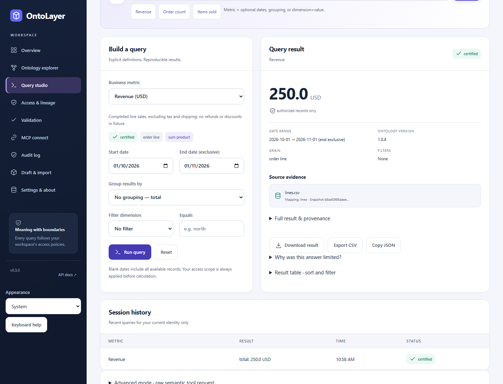
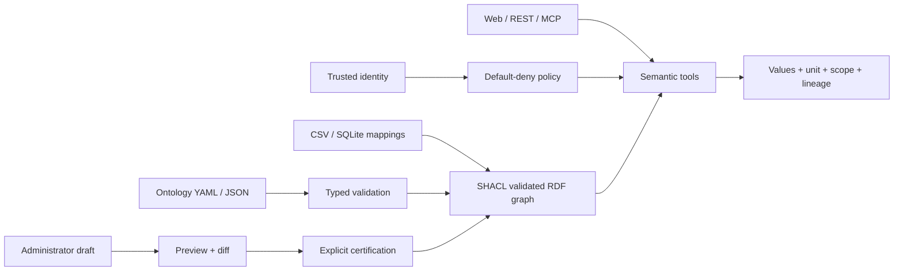

# OntoLayer

**Define business meaning, build a governed knowledge graph, and let people and agents query it with evidence.**



[CI](https://github.com/AshubShafqat/ontolayer/actions/workflows/ci.yml) · [Apache-2.0](LICENSE) · Python 3.12+ · Self-hosted

## 1. What is OntoLayer?

An ontology defines business things such as Customer, Order and Product, their properties and their relationships. OntoLayer maps source data into those definitions, calculates reviewed metrics and enforces access policies before returning results.

Think of it as **a shared dictionary and map of the business that humans and AI agents both read**. The dictionary defines revenue; the map connects order lines to products; policies decide which records a caller may use.

## 2. Problem and audience

Systems often use different names and calculations for the same idea. An agent with only column names can misunderstand a metric or retrieve inappropriate data. OntoLayer supplies named definitions, bounded tools, deterministic calculations and source evidence.

It is for developers building semantic APIs, teams evaluating governed agents and students learning ontology engineering. It is a working small-dataset application, not an enterprise certification. Read the [operating limits](docs/production.md) before deploying private data.

## 3. Glossary

| Term | Meaning |
|---|---|
| Ontology | Versioned definitions, mappings, metrics and policies |
| Concept / object type | A kind of business thing, such as Customer |
| Relationship / link | A named connection, such as Order placedBy Customer |
| Metric | Reviewed calculation with grain, unit and allowed dimensions |
| Knowledge graph | Actual records and connections populated from sources |
| Semantic layer | Business vocabulary and governed query interface above storage |
| Lineage | Source, mapping, version and snapshot hash behind an answer |
| Certification | Explicit reviewer action marking definitions executable |
| Policy | Default-deny grants for roles, records, properties, metrics and PII |
| MCP | Model Context Protocol: agents discover and call standardized tools |

## 4. What works today

| Feature | Where |
|---|---|
| Typed YAML/JSON ontology, owners, versions, interfaces | Definition files; Draft & import |
| CSV/read-only SQLite adapters, RDF graph, SHACL validation | CLI build; workbench CSV preview |
| Governed count, sum and sum-product metrics | Query studio; query_metric |
| Concept/synonym/metric search | Search button or Alt+K |
| Searchable concepts, graph zoom/pan/focus/neighbors/status filters | Explorer |
| Guided queries and advanced JSON tools, charts/table, CSV/JSON exports | Query studio |
| Record inspection and source evidence | Explorer; Access & lineage |
| Independently authenticated identity comparison | Synthetic demo only |
| Scoped linter, audit history, tool catalog/tester | Validation; Audit; MCP connect |
| Administrator drafts, live schema validation, graph preview, diff, certification | Draft & import |
| Durable certified snapshots and restart recovery | --workspace-directory |
| JSON/YAML import; YAML/JSON/OWL-Turtle schema export | Administrator workbench |
| Light/dark/system appearance, mobile menu, shortcuts, offline retry | Workspace |
| Eleven read-only MCP tools; LangGraph reference agent | MCP stdio; CLI ask/evaluate |

Turtle export is structural schema/SHACL, not a lossless encoding of metrics and policies. Browser CSV uploads are limited to 48 KB and 1000 rows; complete requests are limited to 64 KiB. English is available; locale dictionaries and RTL direction scaffolding exist, but Urdu translation is not implemented.

## 5. How it works



For “revenue from 2026-10-01 to 2026-11-01”: resolve a permitted definition, authenticate the caller, filter records/properties by policy, apply the certified metric and exclusive-end date interval, calculate with Decimal, then return values and provenance. Filtering occurs before data reaches a model.

The browser question box uses a constrained parser, not an LLM. The optional CLI agent uses a real MCP subprocess with rules, Ollama or an OpenAI-compatible planner. Generated plans still pass strict validation.

## 6. Five-minute quickstart

Install Git and [uv](https://docs.astral.sh/uv/getting-started/installation/). Initial dependency downloads require internet access. Node is only needed for development/browser checks.

Windows PowerShell:

```powershell
git clone https://github.com/AshubShafqat/ontolayer.git
cd ontolayer
uv sync --locked --python 3.12
.\scripts\dev.ps1 -m ontolayer serve --ontology examples/retail/ontology.yaml --credentials examples/retail/credentials.yaml --demo
```

The wrapper uses installed base Python with project dependencies if Windows blocks the venv launcher. It changes no security settings.

Linux/macOS shell:

```sh
git clone https://github.com/AshubShafqat/ontolayer.git
cd ontolayer
uv sync --locked --python 3.12
uv run ontolayer serve --ontology examples/retail/ontology.yaml --credentials examples/retail/credentials.yaml --demo
```

Expect `Uvicorn running on http://127.0.0.1:8000`. Open **http://127.0.0.1:8000/**, not `/docs`. The demo starts as North. After signing out, `demo-north-token` opens that identity again. These public synthetic credentials are rejected in production mode.

In Query studio choose Revenue, start `2026-10-01`, end `2026-11-01`, then Run query. Expect **250 USD** for North, **350 USD** for South, **600 USD** for Administrator. All-date North revenue is **330 USD**. Inspect source evidence beneath the answer.

Docker:

```sh
docker build -t ontolayer .
docker run --rm -p 127.0.0.1:8000:8000 ontolayer
```

Windows commands are exercised locally; Linux and Docker checks run in CI. A macOS host and public HTTPS deployment have not been independently exercised. The disposable Docker command does not retain changes after removal; operated deployments need persistent state mounts.

## 7. Application tour

| Screen and real screenshot | Goal and controls |
|---|---|
| [Overview](docs/media/v03-overview.png) | Counts, version, permitted totals, health, linter score, certification counts, recent queries/denials |
| [Explorer](docs/media/v03-explorer.png) | Find/filter concepts; inspect properties/relationships; page/filter records; open lineage; focus/zoom/pan map |
| [Query studio](docs/media/v03-studio.png) | Metric, dates, grouping and one guided filter; advanced JSON supports multiple filters; charts, result table, copy/export |
| [Access & lineage](docs/media/v03-access.png) | Current identity; safe record inspection; independently authenticated demo comparison |
| [Validation](docs/media/v03-validation.png) | Scoped warnings, reasons and remedies; score = 100 minus five per warning, floored at zero |
| [MCP connect](docs/media/v03-mcp.png) | Configuration, schemas, examples and REST tester; it does not verify an external MCP client |
| [Audit log](docs/media/v03-audit.png) | Filter user/tool/decision/timestamp; export matching events from the last 1000 process events |
| [Draft & import](docs/media/v03-editor.png) | Administrator document editor; import definitions/CSV, preview full graph/diff, explicitly certify and activate |
| [Settings](docs/media/v03-settings.png) | Version, environment, identity and documentation; appearance/help live in sidebar/mobile menu |

Alt+K opens search; Alt+T switches theme; Ctrl/Command+Enter runs the guided query; Escape closes dialogs. Credentials, query history and permitted definitions remain in page memory. Appearance is stored per identity in this browser. Identity changes clear results and cancel pending requests. Calls time out after 15 seconds; browser cancellation does not necessarily stop server work.

## 8. Define your own ontology

Start with the complete [retail](examples/retail/ontology.yaml) or [agriculture](examples/agriculture/ontology.yaml) example. See the [spec reference](docs/spec.md) and [JSON Schema](spec/ontology.schema.json). This minimal complete definition illustrates the format:

```yaml
namespace: shop
version: 1.0.0
description: Small sales workspace
types:
  Sale:
    description: One completed sale
    owner: finance
    status: certified
    synonyms: [transaction]
    properties:
      amount: {type: number, description: Net sale amount, required: true, unit: USD}
      region: {type: string, description: Sales region, required: true}
links: {} # Named source/target relationships go here.
mappings:
  sales:
    type: Sale
    kind: csv
    path: sales.csv # Relative to the ontology directory; cannot escape it.
    id_column: id
    columns: {amount: amount, region: region} # Business property -> source column.
metrics:
  revenue:
    description: Sum of completed sale amounts
    owner: finance
    type: Sale
    aggregation: sum
    fields: [amount]
    dimensions: [region]
    unit: USD
    grain: sale
    status: certified
policies:
  - role: analyst
    types: [Sale]
    metrics: [revenue]
    properties: {Sale: [amount, region]} # Fields require explicit grants too.
```

Provide `sales.csv` with `id,amount,region` headers. Owners/descriptions are required and references must resolve. Objects/metrics default to draft. Property types: string, integer, number, boolean, date. Aggregates: count, sum, sum_product. Relationships declare source/target types and optional `one` cardinality. Interfaces declare shared properties.

For UI changes, increase the version, edit, preview, review the diff and certify. Preview creates an isolated candidate; it cannot change active definitions. Certification rejects stale revisions, validates the complete graph again, saves a release and replaces the active pointer atomically. Existing mappings can read only trusted source paths; new sources require CSV uploads. Review policy changes carefully because certification can change access.

## 9. Connect an agent over MCP

See [MCP setup](docs/mcp.md). MCP uses stdio, so there is no HTTP MCP URL. A trusted launcher assigns the actor; no tool accepts an actor argument.

```json
{
  "mcpServers": {
    "ontolayer": {
      "command": "uv",
      "args": ["--directory", "/absolute/path/to/ontolayer", "run", "ontolayer", "mcp", "--ontology", "examples/retail/ontology.yaml", "--actor", "examples/retail/north.yaml"]
    }
  }
}
```

Replace the absolute path before using this entry in Claude Desktop, Cursor or a generic stdio client. Installation differs by client. This launches the named file snapshot. For a workbench release, point `--ontology` at its `ontology.yaml` and restart the MCP process. Already-running MCP processes do not follow browser publication automatically.

| Tool | Example input | Output |
|---|---|---|
| search_terms | `{"query":"revenue"}` | Permitted matches, next offset |
| get_concept | `{"concept":"Customer"}` | Definition and visible properties |
| list_entities | `{"concept":"Customer","limit":20}` | Visible records, next offset |
| get_relationships | `{"entity_id":"Customer:C1"}` | Links with visible endpoints |
| find_path | `{"source":"Customer:C1","target":"Order:O1"}` | Bounded visible path |
| get_metric | `{"metric_id":"revenue"}` | Calculation definition |
| check_answerable | `{"metric_id":"revenue"}` | Availability/certification decision |
| query_metric | `{"metric_id":"revenue","group_by":"region"}` | Values, unit, scope and lineage |
| get_lineage | `{"entity_id":"Customer:C1"}` | Source, mapping, snapshot, version |
| explain_policy_decision | `{"entity_id":"Customer:C2"}` | Safe visibility decision |
| list_ontology_versions | `{}` | Current process version |

## 10. HTTP API

Protected requests use `Authorization: Bearer TOKEN`. `/docs` gives exact contracts in development; production disables it and OpenAPI.

| Route | Access / purpose |
|---|---|
| GET /, /static/*, /health, /v1/config | Public UI/assets/basic status |
| GET /v1/workspace | Authenticated permitted definitions/identity |
| POST /v1/ask | Authenticated constrained question planning |
| POST /v1/tools/{operation} | Semantic operation; body `{"arguments":{...}}` |
| GET /v1/catalog, /v1/validation, /v1/audit | Authenticated tools/scoped lint/scoped events |
| GET /v1/ontology, /v1/ontology/export?format=yaml | Administrator definition/export; also json/turtle |
| POST /v1/drafts/validate, /v1/drafts/preview | Administrator schema check / isolated graph preview |
| POST /v1/drafts/{id}/certify | Administrator activation with matching revision |
| GET /metrics | Operator Prometheus counters |

```sh
curl http://127.0.0.1:8000/v1/tools/query_metric -H 'Authorization: Bearer demo-north-token' -H 'Content-Type: application/json' -d '{"arguments":{"metric_id":"revenue","start_date":"2026-10-01","end_date":"2026-11-01"}}'
```

Use `curl.exe` in PowerShell. Expected JSON includes `"values":{"total":"250.0"}`. Values are decimal strings; end dates are exclusive. Errors include code, message, hint, request_id and compatibility detail. Authentication: 401; forbidden: 403; invalid operation: 400; invalid request shape: 422; stale publication: 409; rate limit: 429. Report X-Request-ID when requesting support.

## 11. Security and governance

Policies are additive allow grants; no match means deny. Row policies compare properties with server-trusted actor attributes. PII needs an explicit grant. Rows/properties are filtered before calculation, traversal, lineage or model access. Missing and unauthorized records deliberately receive indistinguishable responses.

Editing requires a trusted `admin` role. Operators see events in their namespace; other users see their own events. Events record identity/tool/outcome/version, not credentials or result bodies. Audit files need external retention/protection. See [policy guide](docs/policy.md) and [security policy](SECURITY.md).

## 12. Configuration

Application settings are CLI flags:

| Flag | Default | Meaning |
|---|---|---|
| --ontology | Required | Initial definition/source directory |
| --credentials | Required for serve | Server-owned token/actor configuration |
| --host / --port | 127.0.0.1 / 8000 | Bind address |
| --demo | Off | Public synthetic sign-in/comparison |
| --production | Off | Reject demo credentials; require explicit hosts/audit |
| --allowed-host | Local hosts in development | Repeat for allowed production Host headers |
| --audit | .ontolayer/audit.jsonl | Persistent event sink |
| --workspace-directory | .ontolayer/workspace | Durable drafts/certified snapshots |

| Environment variable | Default | Meaning |
|---|---|---|
| ONTOLAYER_LLM_API_KEY | Empty | Optional compatible-planner key |
| PYTHONPATH | Interpreter default | Windows helper sets this temporarily |
| ONTOLAYER_EXTERNAL_SERVER | Unset | Browser tests reuse localhost when set |
| APP_HOST | Required for production Compose | Public domain |
| ONTOLOGY_DATA_DIR | Required for production Compose | Absolute reviewed source directory |
| ONTOLOGY_CREDENTIALS | Required for production Compose | Absolute private credential file |

## 13. Deployment and operations

See [production guide](docs/production.md) and [Compose template](deploy/compose.production.yaml). The container runs without root; the production template adds a read-only root filesystem, private mounts, durable state and Caddy HTTPS. This is an operator template, not an already-provisioned deployment.

Supply private credentials, domain/TLS, backup/restore, source validation, ingress limits, monitoring, retention and an appropriate security review. Use **one worker per workspace directory**. Runtime graph/audit history are in memory; certified source snapshots and the active pointer are durable. Do not share a state directory between independent writers. Back up its entire tree plus external credentials/audit files.

No OIDC, HTTP MCP, distributed graph, HA orchestration or document extraction is included. Rate limit: 240 requests per client IP/minute/process. Benchmark real datasets; pagination does not make ingestion streaming. Draft/release retention is an operator responsibility.

## 14. Tests and quality gates

```sh
uv run pytest --cov-fail-under=85
uv run ruff check src tests scripts
uv run ruff format --check src tests scripts
uv run mypy src
npm ci
npx playwright install chromium
npm run test:e2e
npm run test:performance
```

On restricted Windows launchers replace `uv run` with `.\scripts\dev.ps1 -m` for Python modules. Set `$env:ONTOLAYER_EXTERNAL_SERVER='1'` after starting the local preview. Tests cover values, policies, sign-in/out, lineage, exports, publication, offline retry, axe and responsive layouts. Visual baselines at 375/768/1280 are platform-specific; regenerate only after reviewing changes. Lighthouse enforces performance/accessibility/best practices >=90 and an 80 KB gzip static-asset budget. CI checks Python 3.12/3.13, dependencies/SBOM, package builds and Docker startup/query behavior.

[Baseline audit](docs/audit-v0.3.md) · [Release verification](docs/release-v0.3.md)

## 15. Project structure

```text
src/ontolayer/     Contract, adapters, policies, service, API, MCP, agent, workbench
  static/         Browser UI and locale scaffolding
examples/         Retail/agriculture data, definitions, actors and evaluations
spec/             Generated ontology JSON Schema
tests/            Backend, transport, precision, governance and publication tests
e2e/              Browser, axe, responsive and screenshot regression tests
scripts/          Windows Python wrapper; Lighthouse and bundle gate
docs/             Architecture, spec, policies, deployment, audit and screenshots
deploy/           Production Compose/Caddy templates
.github/          CI workflows
.ontolayer/       Ignored local audit/drafts/certified state
```

## 16. Roadmap and limitations

Future work includes remote graph adapters, OIDC, remote MCP authentication, document extraction and visual schema authoring. Graph controls provide button zoom, drag pan, touch taps and browser pinch zoom, not a custom two-finger graph gesture. Authoring is a JSON/YAML document editor. The UI caches permitted definitions in page memory and pages entities, but does not cache arbitrary query responses. Audit browsing covers the current process ring, not historical file ingestion. CSV upload is intentionally bounded.

## 17. FAQ and troubleshooting

- **Why not only an LLM?** Definitions, policies and calculations must remain reproducible independently of a model.
- **Port occupied?** Stop the preview you started or use --port 8001. Do not stop unrelated processes.
- **Token rejected?** Check namespace, credential file and exact token. Production rejects demo tokens.
- **Empty graph?** Check mappings, validation and identity grants. Guest sees no concepts or metrics by design.
- **Draft rejected?** Increase version, fix references/headers/types, then preview. New paths need uploads; stale revisions need reload.
- **Changes absent after restart?** Use the same persistent workspace directory. MCP processes using the original file do not follow browser releases.
- **“Last month” unanswered?** Supply explicit dates; the parser refuses to invent boundaries and suggests permitted metrics.
- **Financial values differ?** Check grain, dates, filters and identity. SQLite REAL has already passed through binary floating point; prefer text/Decimal sources.
- **429 during testing?** Wait for Retry-After; the same-origin API has a shared per-IP minute quota.

## 18. Contributing, license and acknowledgements

Read [Contributing](CONTRIBUTING.md), [Governance](GOVERNANCE.md), [Code of conduct](CODE_OF_CONDUCT.md), [Security](SECURITY.md) and [Apache-2.0](LICENSE). All included data is synthetic. Never contribute private credentials or records.

References: [NVIDIA auto-ontology](https://github.com/NVIDIA/auto-ontology), [ModernRelay Omnigraph](https://github.com/ModernRelay/omnigraph), [TrustGraph](https://github.com/trustgraph-ai/trustgraph), [Palantir ontology practices](https://www.palantir.com/docs/foundry/ontology/ontology-best-practices). These are references, not bundled adapters or affiliation claims.

## Live demo

Public deployment is pending Render account setup and a successful live smoke
test. No live URL or public tokens have been published yet. Follow
[the deployment guide](docs/deploy.md) to deploy one same-origin container and
issue fresh read-only demo tokens. The sign-in screen can display the explicitly
configured north, south and analyst tokens; the admin credential remains private.

The free tier may sleep and loses local state on restart. OntoLayer runs one
process with an in-memory graph. Use a paid persistent disk for durable workspace
snapshots and audit files. The About page is at `/#about` on the deployed origin.
