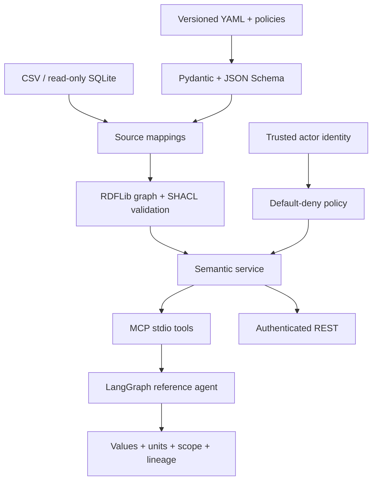

# Architecture and boundaries

`models.py` is the contract. `spec.py` loads it and generates JSON Schema, OWL classes,
properties and SHACL shapes. The RDF export is a structural representation, not a lossless
round-trip encoding of the full YAML policy and metric language.

`sources.py` maps source columns to business properties, normalizes values, assigns stable
`Type:source-id` identifiers, and hashes source snapshots. CSV and SQLite use the same mapping.
`backend.py` constructs a candidate graph and validates the entire batch before publishing it.
Repeated ingestion upserts stable IDs and edges; it does not infer deletions from absent rows.
To refresh a snapshot with deletes, build a fresh service instance.

`GraphBackend` is a protocol with `apply_schema`, `upsert`, `entities`, `edges`, and `export`.
The initial implementation is an in-process RDFLib graph. Semantic operations belong above
storage, so agents never supply backend-specific query languages. Future remote backends need
conformance, pagination, pushdown, and transaction tests; merely matching method names is insufficient.

`policy.py` evaluates additive allow rules. No matching rule means no access. Each rule grants
explicit types, properties and metrics. Row constraints compare entity properties to trusted actor
attributes. Missing attributes fail closed. PII also requires `allow_pii`. A broader matching role
adds access; there are no explicit deny rules or deny-precedence semantics in v0.1.

`service.py` filters rows before calculations, graph traversals, or lineage lookup. Metric execution
supports count, sum and sum of two multiplied fields; it never executes arbitrary generated code.
Results serialize decimal calculations as strings to avoid a JSON floating-point round trip.
CSV numeric values are parsed as Decimal and exposed as decimal strings to avoid binary floating-point
conversion. Source precision is limited to 28 significant digits; SQLite REAL inputs have already
been converted by the database and cannot recover lost precision. Use text for exact SQLite values.

One process serves one namespace and active version. The web workbench stores isolated drafts
and source copies, validates candidates, and requires explicit administrator certification.
Certification publishes a durable active pointer and swaps the validated graph under a lock.
Startup restores that snapshot from the workspace directory. Use one writer process; this is not
a distributed transaction system. REST and MCP share the same semantic implementation, but
a separately launched MCP process retains its own file snapshot until restarted against a release.
Local CLI commands operate under the trusted file owner's authority; they are not remote tools.

The LangGraph agent resolves permitted definitions over MCP, creates a bounded query plan, checks
answerability, executes a metric over MCP, and renders the actual result with provenance. Its default
parser deliberately supports a small grammar. Ollama and OpenAI-compatible planners can handle
broader language; model plans are still validated by the deterministic service. The final numerical
answer is assembled from tool output, not freely generated by a model.

## Current limits

- The in-memory runtime is intended for small reference datasets, not warehouse-scale workloads.
- No persistent backend, Omnigraph/Neo4j integration, arbitrary SQL, or general SPARQL endpoint.
- No automatic document extraction, full OWL reasoning or lossless Ossie import.
- The browser workspace is bundled with the package and served at `/`; it shares REST authorization.
- Drafting from CSV headers is deterministic scaffolding; it cannot discover business meaning.
- Certification requires a trusted local maintainer or authenticated administrator.
- OIDC, remote MCP HTTP authentication, distributed tenancy, Helm, and signed PyPI publishing
  are later deployment work; Docker is optional and does not replace those controls.

These boundaries are intentional and documented rather than exposed as placeholder features.
